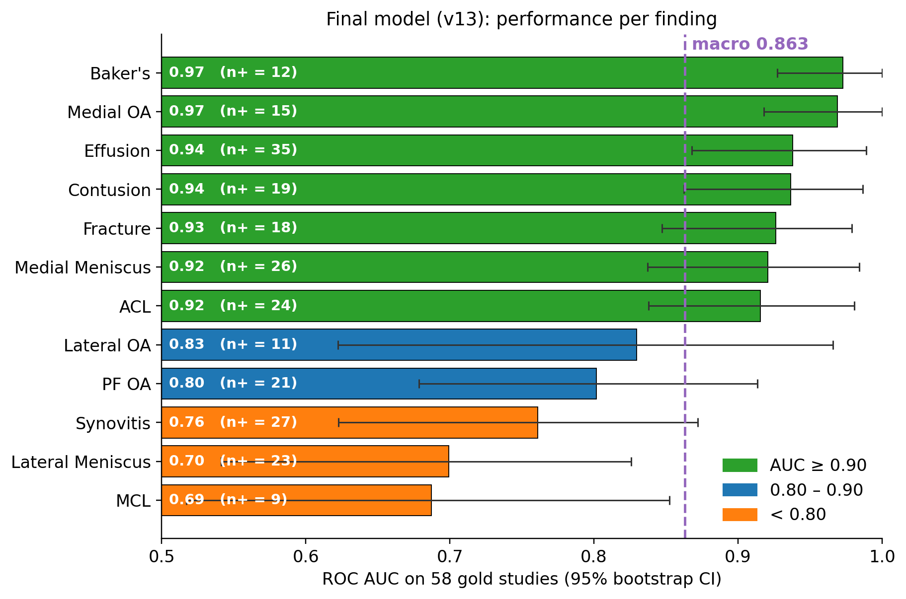
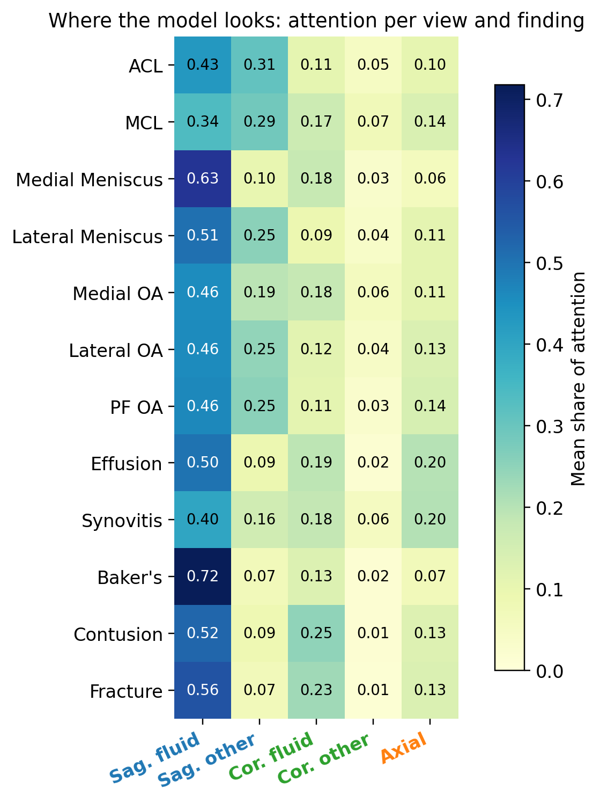

# Knee MRI Abnormality Detection from Report-Derived Labels

Multi-label detection of 12 knee abnormalities on MRI, trained **without expert image labels**.
Training labels come from the free-text radiology reports (in Spanish, English, German, Dutch,
French and Italian). Three report readers score each report, and their scores are averaged into
soft labels. A 2.5D ConvNeXt model with one attention map per finding then learns from those labels.

Data: [RSNA 2026 Knee Abnormality Detection](https://www.kaggle.com/competitions/rsna-knee-abnormality-detection)
(Kaggle). Metric: macro ROC AUC over the 12 findings.

**Final model: 0.880 macro AUC on the hidden test set, 0.863 on the 58 expert-labelled studies.**

Findings: ACL, MCL, medial meniscus, lateral meniscus, medial OA, lateral OA, patellofemoral OA,
effusion, synovitis, Baker's cyst, bone contusion, fracture.



## How it works

```
Reports ──► regex labeller ─┐
        ──► MedGemma-4B ────┼─► average ─► soft labels (L4) ─┐
        ──► Qwen 27B (local)┘                                 │
                                                              ▼
MRI series ──► 5-slot slice cache (64 slices) ──► ConvNeXt-Tiny + per-finding attention ──► 12 scores
```

1. **Report labelling.** Three labellers turn each report into 12 scores between 0 and 1:
   - a rule-based **regex** labeller (anatomy + pathology terms, with a negation check),
   - **MedGemma-4B-it** (JSON output, greedy decoding),
   - a **Qwen 27B** community fine-tune (GGUF, 2-bit) served locally with Ollama on a laptop.
2. **Label fusion.** The three scores are averaged; regex blanks (finding not mentioned) are skipped.
3. **Slice cache.** Each study becomes one fixed stack: 5 slots (sagittal fluid-sensitive 18,
   sagittal other 14, coronal fluid-sensitive 12, coronal other 8, axial 12 = 64 slices),
   140 mm physical crop, 256 or 384 px. The slot layout and crop are adapted from public solutions
   shared in the challenge.
4. **Image model.** Windows of 3 neighbouring slices (2.5D) go through ConvNeXt-Tiny (ImageNet).
   A slot embedding marks the view. Each finding has its own attention over all windows.
5. **Training.** AdamW, warm-up then cosine schedule. The 384 px model is warm-started from the
   256 px model. The 58 expert-labelled studies are never used for training; they pick the best epoch.

## Results

### Report labellers (ROC AUC vs 58 expert-labelled studies)

| Labeller | Macro AUC |
|---|---|
| Regex | 0.683 |
| MedGemma-4B | 0.768 |
| Qwen 27B (2-bit, local) | 0.858 |
| **Average of three (L4)** | **0.870** |

### Image models

| Run | Change | Gold (58) | Hidden test |
|---|---|---|---|
| v10 | 256 px, 64 slices, labels L3 (regex + MedGemma) | 0.837 | 0.842 |
| v10_384 | v10 at 384 px | 0.845 | 0.839 |
| v11 | v10 with labels L4 (adds Qwen) | 0.854 | 0.865 |
| **v13** | **v11 at 384 px (final)** | **0.863** | **0.880** |
| v12 | v11 + left/right knee alignment | 0.848 | – |
| v14 | v11 with ConvNeXt-Small | 0.806 | – |
| v15 | v11 + agreement-weighted loss | 0.802 | – |
| v16 | v11 with refined Qwen prompt (L5) | 0.849 | – |

Earlier baseline (Phase 1): ResNet18 / RadImageNet ResNet50 with slice and series attention,
5-fold CV on the 58 gold studies: best single run 0.679, 15-model ensemble 0.723.

**Main lesson:** the quality of the labels sets the ceiling. The biggest hidden-test gain came from
better labels (v10 → v11), not from a bigger image model.

<p align="center">
  <br>
  <em>Share of attention per view. The model relies mostly on sagittal fluid-sensitive images,
  even for the MCL, which radiologists read on coronal images.</em>
</p>

## Repository layout

```
labelling/
  export_reports.py       export report text + gold labels to one CSV
  regex_labeler.py        labeller 1: rule-based, multilingual, negation-aware
  medgemma_validate.py    labeller 2: MedGemma prompt, model loading, gold-set scoring
  medgemma_label_all.py   labeller 2: run on all reports
  qwen_score.py           labeller 3: local Qwen via Ollama, gold-set scoring
  qwen_prompt_v2.py       refined prompt for 4 findings (label set L5)
  fuse_labels.py          average the three labellers into soft labels
pipeline/                 main model (Kaggle notebooks, exported as scripts)
  build_cache.py          DICOM -> 5-slot, 64-slice cache (CPU)
  train.py                2.5D ConvNeXt + per-finding attention (GPU)
  submit.py               hidden-test inference (internet off)
notebooks/
  figures.ipynb           all figures for the final model
phase1/                   earlier baseline (ResNet + series attention, 5-fold CV)
  model.py  dataset.py  run_cv.py
figures/                  result figures
```

## Label sets

| Name | Source |
|---|---|
| L3 | regex + MedGemma |
| L4 | mean of regex, MedGemma and Qwen (regex blanks skipped) — used by the final model |
| L5 | L4 with a refined Qwen prompt for effusion, synovitis, contusion and fracture |

Output file names keep an older numbering (for example `final_labels_soft_v4.csv` holds L4).

## Running

```bash
pip install -r requirements.txt
```

- **Labelling** runs on a local machine. Set `KNEE_ROOT` to a folder that holds `data/`
  (competition CSVs) and `outputs/`. Qwen needs [Ollama](https://ollama.com) with the model
  pulled; MedGemma needs a GPU and access to the model on Hugging Face.
- **Pipeline** scripts were run as Kaggle notebooks with the competition data attached:
  `build_cache.py` (CPU) → `train.py` (GPU T4/P100) → `submit.py` (GPU, internet off).
  About 6 minutes per epoch at 256 px.

No competition data, reports or model weights are included in this repository.

## Limitations

- Only 58 expert-labelled studies, so small differences between runs are uncertain.
- All test data come from the same challenge; there is no external test set.
- Scores are not calibrated, and the model may have learnt site-specific patterns.
- This is a research prototype, not a diagnostic tool.

## Acknowledgements

- RSNA for the challenge data.
- [MedGemma](https://huggingface.co/google/medgemma-4b-it) (Google), [Qwen](https://github.com/QwenLM) and
  the community GGUF fine-tune used for local labelling, [timm](https://github.com/huggingface/pytorch-image-models)
  for ConvNeXt, and [RadImageNet](https://www.radimagenet.com/) for the Phase 1 backbone.
- Public solutions shared in the challenge, from which the slot layout and crop were adapted.

## License

Code: MIT (see `LICENSE`). Data and model weights follow their own licences.
